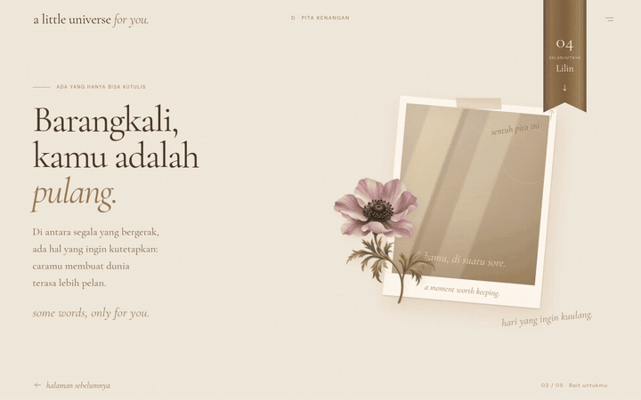
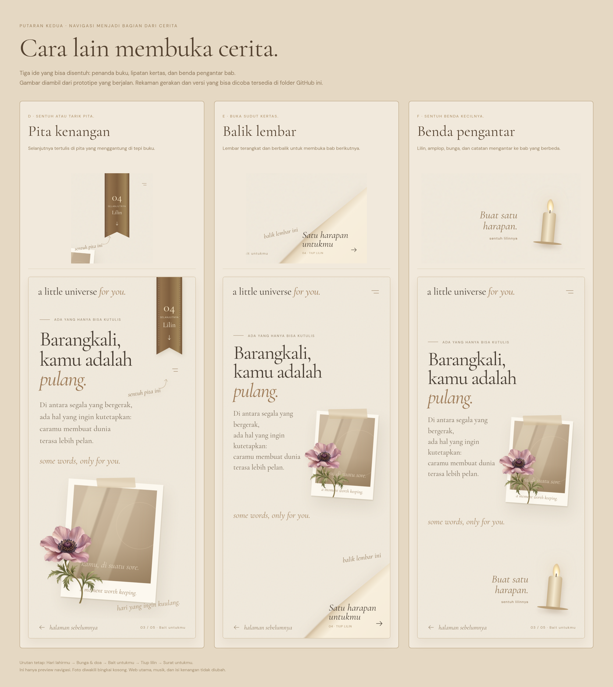

# Tiga ide baru: pita, lembar, dan benda pengantar

Putaran kedua ini mencoba navigasi yang menjadi bagian dari benda-benda dalam cerita. Ada **pita buku yang ditarik, sudut kertas yang dibuka, dan benda pengantar yang berubah di setiap bab**.

**[Tonton gerakan D → E → F](https://raw.githubusercontent.com/MalikHariyanto/Sistem-BTD/preview/navigation-options/docs/navigation-atelier/motion/transisi-d-e-f.mp4)** · **[Download preview yang bisa dicoba](https://raw.githubusercontent.com/MalikHariyanto/Sistem-BTD/preview/navigation-options/docs/navigation-atelier/preview-nav-romantis.zip)**

Website utama belum diubah. Preview berada di branch `preview/navigation-options`.

## Lihat gerakannya dahulu

Ini rekaman prototipe yang berjalan di browser. Setiap konsep dimulai dari puisi lalu membuka bab lilin, supaya gerakannya mudah dibandingkan. Label D, E, dan F di atas video hanya penanda rekaman.

Kalau GIF belum berjalan atau gambarnya tidak muncul, **[buka video MP4 langsung](https://raw.githubusercontent.com/MalikHariyanto/Sistem-BTD/preview/navigation-options/docs/navigation-atelier/motion/transisi-d-e-f.mp4)**. Video juga bisa diunduh.

| Ide | Cara memakainya | Rasa perpindahannya | Pilih kalau… |
| --- | --- | --- | --- |
| **D · Pita kenangan** | Sentuh pita bertuliskan nama bab berikutnya. Bisa juga ditarik sedikit ke bawah. | Pita bergerak turun, lalu kertas berikutnya muncul lembut. | Kamu suka kesan album pribadi dengan penanda buku yang selalu mudah ditemukan. |
| **E · Balik lembar** | Sentuh sudut kertas yang terlipat. Tujuannya tertulis pada lipatan. | Satu lembar terangkat dan berbalik dengan perspektif 3D. | Kamu ingin sensasi membuka buku, dengan transisi yang paling terasa gerakannya. |
| **F · Benda pengantar** | Sentuh benda kecil beserta ajakannya: bunga, catatan, lilin, atau amplop. | Benda terangkat sedikit, lalu menyatu dengan kemunculan bab berikutnya. | Kamu ingin setiap perpindahan punya karakter dan kejutan sendiri. |

Aku condong ke **F untuk rasa yang paling personal**, atau **E untuk sensasi membuka halaman yang paling jelas**. D lebih tenang dan memberi satu penanda yang konsisten.

## Gambar perbandingan

Bagian atas setiap kolom memperbesar detail navigasinya; bagian bawah menunjukkan komposisinya di HP. Klik gambar untuk memperbesar.

**[Buka gambar ukuran penuh](https://raw.githubusercontent.com/MalikHariyanto/Sistem-BTD/preview/navigation-options/docs/navigation-atelier/images/perbandingan-baru.png)**

| Konsep | HP | Laptop | Rekaman tersendiri |
| --- | --- | --- | --- |
| **D · Pita** | [Lihat gambar](images/d-hp.png) | [Lihat gambar](images/d-laptop.png) | [Video D](https://raw.githubusercontent.com/MalikHariyanto/Sistem-BTD/preview/navigation-options/docs/navigation-atelier/motion/d.mp4) |
| **E · Lembar** | [Lihat gambar](images/e-hp.png) | [Lihat gambar](images/e-laptop.png) | [Video E](https://raw.githubusercontent.com/MalikHariyanto/Sistem-BTD/preview/navigation-options/docs/navigation-atelier/motion/e.mp4) |
| **F · Benda** | [Lihat gambar](images/f-hp.png) | [Lihat gambar](images/f-laptop.png) | [Video F](https://raw.githubusercontent.com/MalikHariyanto/Sistem-BTD/preview/navigation-options/docs/navigation-atelier/motion/f.mp4) |

Pada F, bendanya berubah mengikuti tujuan:

- Hari lahirmu → **rangkaian bunga** untuk membuka doa.
- Bunga & doa → **catatan kertas** untuk membuka puisi.
- Bait untukmu → **lilin** untuk membuat harapan.
- Tiup lilin → **amplop bersegel** untuk membuka surat terakhir. [Lihat contoh amplop di HP](images/f-amplop-hp.png).
- Surat untukmu → **bintang kecil** untuk membaca cerita dari awal.

## Coba sendiri tanpa instalasi

1. **[Download ZIP](https://raw.githubusercontent.com/MalikHariyanto/Sistem-BTD/preview/navigation-options/docs/navigation-atelier/preview-nav-romantis.zip)**, lalu ekstrak.
2. Buka **`preview-siap-buka.html`** di browser.
3. Pilih D, E, atau F di atas preview. Contohnya dimulai dari bab puisi.
4. Coba sentuh pita, lipatan, atau bendanya. Untuk kembali, gunakan **halaman sebelumnya** di kiri bawah. Ikon dua garis membuka daftar isi.

Pita dapat disentuh biasa; menariknya adalah pilihan tambahan. Tidak perlu menguasai gesture. Semua konsep menyebut tujuan berikutnya dan bisa digunakan dengan keyboard.

Paket HTML bisa dipakai offline. Font dan ilustrasinya tertanam di dalam file. GitHub menampilkan kode HTML; unduh filenya dahulu agar bisa dicoba. Alternatif unduh satu file: buka [HTML mandiri](preview-siap-buka.html), lalu gunakan **Download raw file** di GitHub.

## Apa yang ditunjukkan preview ini

Preview berfokus pada **mekanisme navigasi, komposisi kontrol, dan gerakan perpindahannya**. Bingkai foto masih berupa tempat kosong; ilustrasi cahaya di dalamnya bukan foto yang gagal dimuat. Tidak ada foto pribadi atau musik yang diunggah dalam paket ini.

Teks, puisi, dan lilin di dalam contoh adalah isi singkat untuk mencoba lima bab. Interaksi lengkap puisi, bunga, tiup lilin, surat bergulir, serta Gargantua tetap mengikuti web utama ketika konsep terpilih nanti diterapkan.

Konten panjang bergulir di ruang bacanya. Header dan kontrol bab memiliki tempat tersendiri supaya tidak menimpa teks. Untuk ukuran HP 390 px, E dan F menempatkan bait di kiri dan foto di kanan. Pada HP yang lebih sempit, isinya kembali tersusun vertikal.

Gambar disimpan pada skala 2×: viewport HP 390 × 844 dan laptop 1440 × 900. Video memakai viewport 1280 × 800. GIF adalah versi ringkas untuk perbandingan; HTML dan MP4 menunjukkan gerakan lebih lengkap.

## Verifikasi

Ketiga konsep diuji pada 320 × 568, 390 × 844, dan 1440 × 900: lima bab dapat dibuka, kembali dan baca ulang bekerja, daftar isi dapat dipilih, dan keyboard dapat menutupnya. HTML diuji tanpa jaringan. Transisi normal selesai dan membersihkan lapisannya; menarik pita maju tepat satu bab, termasuk ketika reduced motion aktif.

Belum ada pengujian dengan penerima sebenarnya. Preview ini membantu memilih arahnya sebelum navigasi web utama diubah.

Untuk membuat ulang artefak: `python3 scripts/package-navigation-atelier.py` membangun HTML/ZIP; `node scripts/capture-navigation-atelier.mjs` membuat gambar dan sumber video dengan Playwright. Diperlukan dependensi repo, Chromium, dan FFmpeg untuk rekaman. `CHROMIUM_PATH` dan `ATELIER_VIDEO_DIR` dapat mengubah lokasi browser dan keluaran video.
