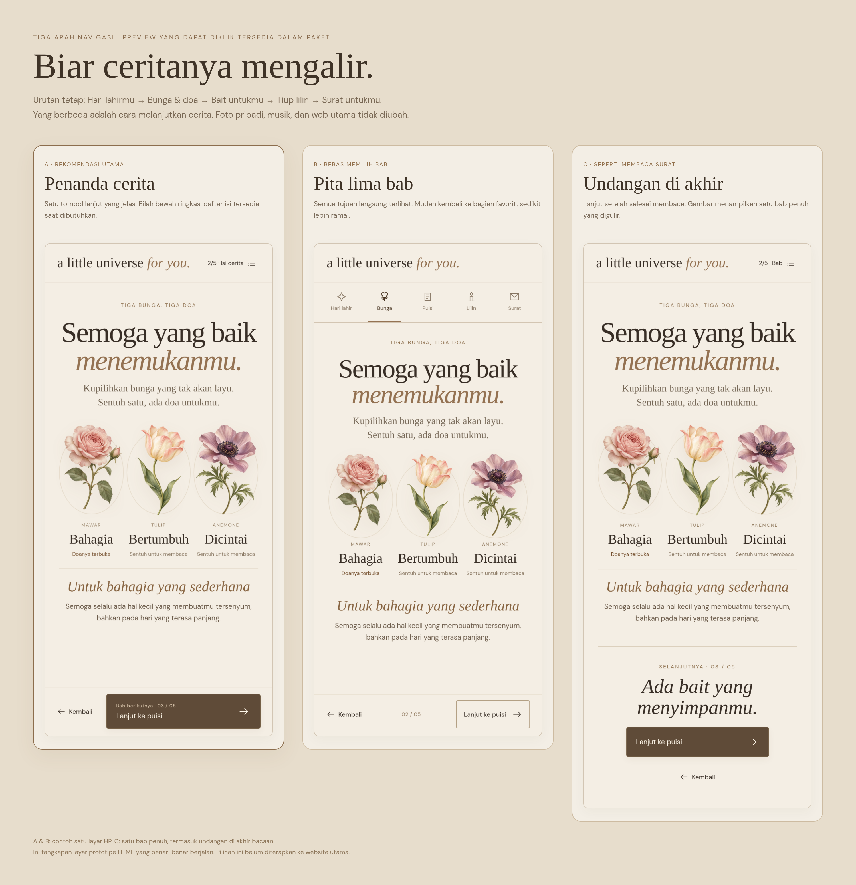

# Tiga pilihan navigasi untuk cerita ulang tahun

**Rekomendasiku: A — Penanda cerita.** Tombol lanjut menjadi tindakan yang paling jelas, dengan nama tujuan seperti **“Lanjut ke puisi”**. Penerima bisa mengikuti kejutan dari awal sampai akhir tanpa perlu memahami ikon atau menebak fungsi garis kecil.

Ini preview terpisah di branch `preview/navigation-options`. Navigasi website utama belum diganti. Foto pribadi dan musik tidak disertakan; contoh isi hanya untuk mencoba perpindahan bab.

## Lihat perbandingannya

Klik gambar untuk memperbesar. Gambar diambil dari prototipe HTML yang dapat dijalankan, sehingga tampilannya sama dengan contoh yang bisa dicoba.

**[Buka gambar perbandingan ukuran penuh](https://raw.githubusercontent.com/MalikHariyanto/Sistem-BTD/preview/navigation-options/docs/navigation-preview/images/perbandingan.png)**

| Pilihan | Cara memakainya | Cocok kalau… | Pertimbangannya |
| --- | --- | --- | --- |
| **A · Penanda cerita — rekomendasi** | Tombol besar bertuliskan tujuan berikutnya. Tombol kembali lebih tenang. Posisi `2/5` dan **Isi cerita** ada di header. | Kamu ingin alur kejutan yang rapi dan mudah dipahami sejak pertama membuka. | Daftar bab dibuka saat dibutuhkan, jadi tidak semuanya terlihat sekaligus. |
| **B · Pita lima bab** | Lima ikon **dengan nama bab**, semuanya dapat disentuh. Tombol lanjut tetap tersedia. | Penerima kemungkinan sering kembali ke bunga, puisi, atau surat favoritnya. | Baris bab memakai sebagian ruang layar dan mengungkap semua kejutan dari awal. |
| **C · Undangan di akhir** | Setelah membaca, muncul ajakan seperti **“Ada bait yang menyimpanmu”**, diikuti tombol **“Lanjut ke puisi”**. Daftar bab tersedia di header. | Kamu ingin suasana membaca yang paling tenang, seperti membuka halaman surat. | Bab panjang harus digulir sampai akhir untuk menemukan ajakan lanjut. |

Urutannya sama untuk ketiganya: **Hari lahirmu → Bunga & doa → Bait untukmu → Tiup lilin → Surat untukmu.**

## Coba langsung tanpa instalasi

1. **[Download paket ZIP](https://raw.githubusercontent.com/MalikHariyanto/Sistem-BTD/preview/navigation-options/docs/navigation-preview/preview-navigasi.zip).**
2. Ekstrak ZIP, lalu buka **`preview-siap-buka.html`** di Chrome, Edge, Firefox, atau Safari.
3. Pilih **A, B, atau C** di atas preview. Coba lanjut, kembali, daftar bab, dan ketuk tiga bunganya.

Paket bisa dibuka offline. Tidak perlu menjalankan terminal, menginstal paket, atau mengunggah foto.

Alternatif: buka **[file HTML siap pakai](preview-siap-buka.html)** di GitHub, lalu klik **Download raw file** di kanan atas tampilan file. Buka file yang sudah diunduh. GitHub menampilkan sumber HTML; prototipe berjalan setelah filenya dibuka di browser.

## Gambar HP dan laptop

| Pilihan | HP | Laptop |
| --- | --- | --- |
| **A** | [Lihat A di HP](images/a-hp.png) | [Lihat A di laptop](images/a-laptop.png) |
| **B** | [Lihat B di HP](images/b-hp.png) | [Lihat B di laptop](images/b-laptop.png) |
| **C** | [Lihat C di HP](images/c-hp.png) | [Lihat C di laptop](images/c-laptop.png) |

[Lihat daftar isi yang terbuka pada opsi A](images/a-daftar-isi.png).

Gambar A dan B menampilkan satu layar HP berukuran 390 × 844. Gambar C menampilkan **satu bab utuh termasuk bagian yang digulir**, agar judul dan undangan di akhirnya sama-sama terlihat. Gambar laptop memakai viewport 1440 × 900. File PNG disimpan dengan skala 2× supaya teks dan ornamen tetap tajam ketika diperbesar.

## Kenapa A paling cocok untuk web ini

- **Tujuannya tertulis.** “Lanjut ke puisi” menjelaskan tindakan lebih cepat daripada sebuah panah tanpa keterangan.
- **Satu tindakan paling menonjol.** Tombol kembali dan daftar isi tetap tersedia, dengan bobot visual yang lebih ringan.
- **Bilah bawah ringkas.** Pada contoh HP, tingginya sekitar 82 px. Konten bergulir di area sendiri, sehingga tombol tidak menutupi doa, foto, atau surat.
- **Jumlah bab jelas.** `2/5` membantu penerima memahami posisinya. Daftar isi menyebut nama semua bagian.
- **Gerakannya lembut.** Isi muncul dengan dissolve singkat 240 ms, tanpa menunggu header atau footer lama menghilang. Preferensi reduced motion dihormati.

Tombol **pindah bab** harus tetap berbeda dari tombol **pilih puisi**, **buka doa**, dan **tiup lilin**. Preview ini menunjukkan hierarki navigasinya; interaksi lengkap puisi, lilin, surat bergulir, musik, dan Gargantua tetap mengikuti implementasi web utama ketika opsi terpilih nanti diterapkan.

## Verifikasi preview

Dicoba di viewport HP 320 × 568 dan 390 × 844 serta laptop 1440 × 900: tombol lanjut, kembali, pemilihan bab, dan kembali ke awal bekerja. Konten tidak meluber secara horizontal. HTML mandiri diuji dengan jaringan dimatikan; font dan ilustrasinya ditanam di dalam file. Pemeriksaan tambahan mencakup semua lima bab, tombol keyboard, dan preferensi reduced motion.

Ini rekomendasi berdasarkan prinsip desain dan pengujian fungsi; belum ada pengujian dengan penerima sebenarnya.

Untuk pengembang: `index.html` adalah sumber prototipe dengan aset lokal di `assets/`. Jalankan `python3 scripts/package-navigation-preview.py` untuk membangun ulang HTML mandiri dan ZIP. Dari root repo, setelah dependensi terpasang, jalankan `node scripts/capture-navigation-previews.mjs` untuk membuat ulang gambar menggunakan Chromium. Generator dapat menerima `CHROMIUM_PATH` jika lokasi browser berbeda.
