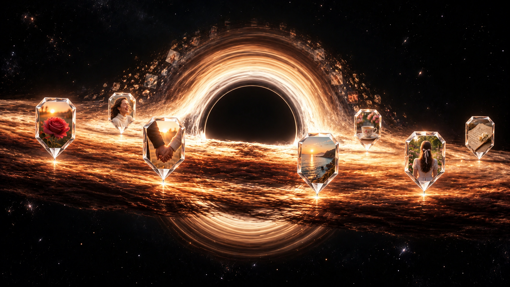
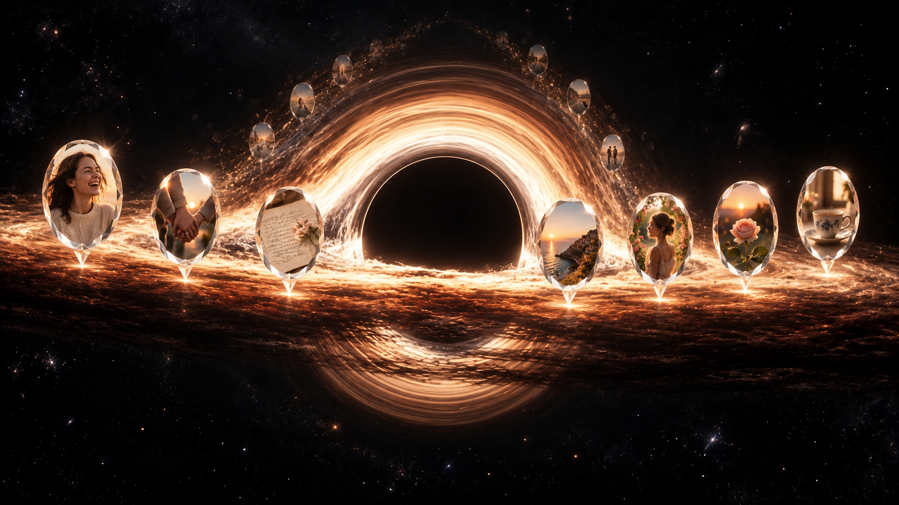
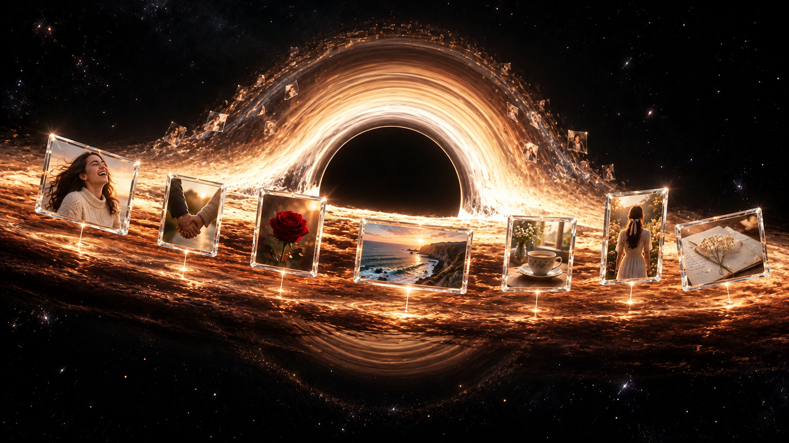

# Tiga preview: kenangan dari cahaya

Tiga gambar konsep untuk bagian tengah perjalanan Gargantua. Ini preview desain statis, belum diterapkan ke website. Foto di dalam bingkai adalah contoh ilustratif, bukan unggahan pribadi.

**[Unduh seluruh preview dan galeri offline (ZIP)](../crystal-orbits.zip?raw=true)**

Setelah diunduh, ekstrak ZIP lalu buka **index.html**. Ketiga gambar bisa dibandingkan dan dibuka penuh tanpa instalasi, server, atau koneksi internet. PNG asli masing-masing berukuran **1672 × 941 pixel**.

## A — Crystal Pin

Paling dekat dengan konsep penanda lokasi: foto berada dalam bingkai kristal putih bersegi, dengan ujung kecil yang menunjuk ke titik asalnya di cakram. Kilau tepi dan titik cahaya memperlihatkan hubungan foto dengan material di bawahnya.

**[Buka / unduh PNG A](a-crystal-pin.png?raw=true)**

## B — Crystal Cameo

Foto dibingkai oval seperti kenang-kenangan dalam liontin kristal. Lebih lembut dan personal, tetap memakai titik asal bercahaya pada cakram depan.

**[Buka / unduh PNG B](b-crystal-cameo.png?raw=true)**

## C — Crystal Gallery

Bingkai persegi dengan tepian kristal tipis dan pantulan putih. Foto portrait dan landscape tetap mendapat bentuk aslinya; garis cahaya pendek menghubungkannya dengan lokasi pada cakram.

**[Buka / unduh PNG C](c-crystal-gallery.png?raw=true)**

## Arahan bersama

- Satu Gargantua dan satu cakram yang menyambung, dengan kamera lurus ke pusat.
- Foto pada lengkungan belakang semakin kecil dan memudar ketika naik. Puncaknya hampir kembali menjadi filamen cahaya.
- Foto yang jelas berada di aliran horizontal depan. Jarak antarbingkai memberi ruang agar gambar tetap mudah dilihat.
- Bingkai kristal putih, kilau kecil pada tepian, dan titik asal pada cakram. Pantulan amber berasal dari cahaya lingkungan.
- Untuk animasi nantinya: titik asal dan bingkai mengikuti orbit yang sama. Tidak ada penanda yang diam di layar atau foto yang menembus pusat gelap.

**Rekomendasi:** A paling dekat dengan ide penanda lokasi; C cocok jika rasio asli dan keterbacaan foto lebih diutamakan. Ketiganya adalah arah visual untuk dipilih, bukan rekaman renderer saat ini. Intensitas kilau dan kepadatan final perlu dinilai lagi ketika bergerak di HP dan laptop.

Preview disimpan di cabang `preview-crystal-orbits`. File website pada `main` tidak diubah.
