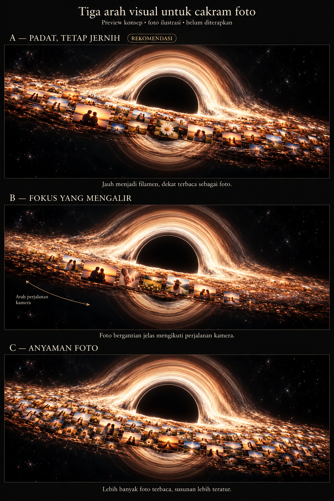

# Preview Gargantua A / B / C

## Cara membuka

1. Unduh [paket ZIP](../gargantua-abc.zip), lalu ekstrak.
2. Buka `preview.png` dengan aplikasi foto, atau buka `index.html` di browser.
3. Halaman HTML dan gambar tersedia sepenuhnya offline; tidak perlu Colab, Python, npm, atau instalasi lainnya.

Jika hanya ingin gambarnya, [unduh PNG langsung](https://github.com/MalikHariyanto/Sistem-BTD/raw/refs/heads/preview-gargantua-abc/previews/gargantua-abc/preview.png).

## Pilihan

- **A — Padat, tetap jernih:** keping jauh menyatu sebagai filamen; foto dekat terbaca dan diberi jarak. Rekomendasi untuk keseimbangan kepadatan dan kejernihan.
- **B — Fokus yang mengalir:** area foto yang jelas mengikuti perjalanan kamera; foto bergantian terbaca.
- **C — Anyaman foto:** lebih banyak thumbnail terlihat, dengan susunan yang lebih teratur.

Gambar ini adalah ilustrasi konsep dengan foto ilustrasi, bukan hasil render atau rekaman animasi final. Branch `preview-gargantua-abc` hanya menambahkan berkas preview; implementasi animasi dan branch `main` belum diubah.
